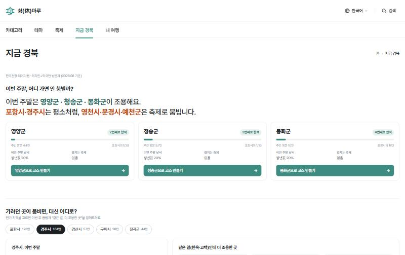
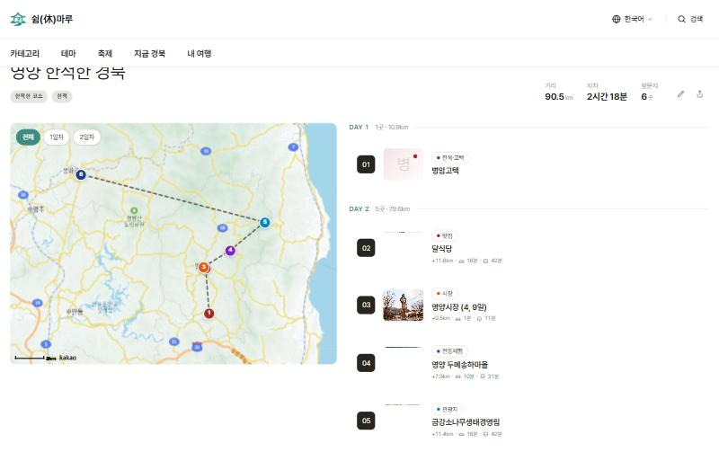
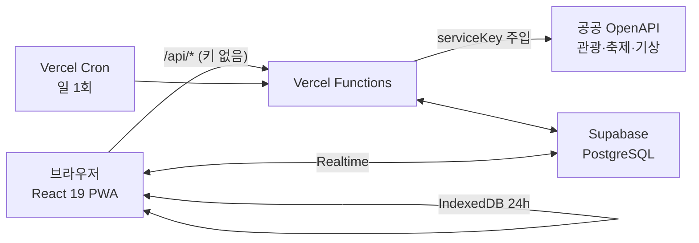

# 쉼(休)마루 · StayMaru
> 경상북도를 처음 찾는 여행자가 숙소·동선 고민 없이 전통문화 코스를 받아볼 수 있는 다국어 PWA

| 지금 경북 — 데이터로 보는 한적한 시·군 | 코스 결과 — 지도 동선과 일자별 일정 |
|---|---|
|  |  |

- 서비스: [staymaru.vercel.app](https://staymaru.vercel.app)
- 개발 기간: 2026.05 ~ 2026.10
- 개발 인원: 2명
- 담당 역할: 전체 설계 및 구현 — 프런트엔드 전반, API 게이트웨이, 코스 생성 엔진, 장소 DB 적재 파이프라인, 운영자 화면, 배포. 팀원 개선분(데이터 인사이트·숨은코스·리포트) 통합

## 1. 프로젝트 소개

**개발하게 된 배경**

경상북도 22개 시군은 한옥·서원·사찰·전통시장 등 전통문화 자원 밀도가 전국 최고 수준이지만, 방문은 안동·경주 같은 일부 지역에 쏠립니다. 여행자 입장에서는 "경북에 뭐가 있는지"보다 **"흩어진 곳들을 며칠 일정으로 어떻게 묶는지"** 가 더 어려운 문제였습니다.

**주요 대상 사용자**

- 경북을 처음 찾는 국내 여행자 — 어디부터 봐야 할지 모르는 사람
- 외국인 관광객 — 영어·일본어·중국어로 같은 정보를 찾는 사람
- 붐비는 곳을 피하고 싶은 여행자 — 유명 관광지 대신 한적한 곳을 찾는 사람

**해결하려는 문제**

1. 흩어진 전통문화 공간을 **하나의 동선**으로 묶어주기
2. 검색 결과 나열이 아니라 **지금 조건(날씨·기간·동반자)에 맞는 코스**를 제시하기
3. 유명 관광지 쏠림 대신 **데이터로 확인된 한적한 시군**을 먼저 보여주기

## 2. 주요 기능

- **코스 자동 생성** — 지역·기간·동반자·취향을 고르면 장소 선정부터 방문 순서까지 자동 설계. 카테고리 가중치 × 거점 반경 × 한적지수 × 동반자 가중치 × 강수확률로 후보를 점수화한 뒤 2-opt로 동선을 최적화합니다.
- **조건 기반 추천** — 비 오는 날에는 박물관·한옥·전통시장 같은 실내 장소의 가중치를 자동으로 올리고, 둘레길은 내립니다. 기상청 단기예보 실연동.
- **숨은 경북 코스** — 데이터랩 외부 방문객 통계로 시군별 한적지수를 산출해, 붐비지 않는 지역 위주의 코스를 만듭니다.
- **데이터 인사이트** — 22개 시군의 방문자 분포를 버블 지도와 랭킹으로 제공. 지도를 못 보는 환경에서도 같은 데이터를 목록으로 읽을 수 있습니다.
- **다국어 (한·영·일·중)** — UI 번역만이 아니라 **공공 API 엔드포인트 자체를 언어별로 전환**해 장소 설명까지 해당 언어로 받아옵니다.
- **실시간 협업** — 로그인 없이 코스 키(`GB-XXXXX`)만으로 친구와 같은 코스를 동시에 편집.
- **PWA** — 홈 화면 추가, 오프라인에서도 앱 셸과 캐시된 코스가 열립니다.

## 3. 기술 스택

| 구분 | 기술 |
|---|---|
| Frontend | React 19, TypeScript, Vite 7, Tailwind CSS, Zustand, React Router, i18next, vite-plugin-pwa |
| Backend | Vercel Functions (Node.js) — 통합 프록시 · 코스 생성 · 운영자 API · Cron 동기화 |
| Database | Supabase (PostgreSQL) — 장소 적재, 저장 코스, 방문자 통계, 운영자 콘텐츠 |
| External API | 한국관광공사 TourAPI(국·영·일·중 / 무장애 / 반려동물 / 연관추천 / 데이터랩), 행정안전부 문화축제 표준데이터, 기상청 단기·중기예보, Kakao Map SDK |
| Infra / 배포 | Vercel (CDN 캐시, Cron Jobs), GitHub |

### 주요 기술 선택 이유

- **Vercel Functions** — API 키를 프런트에 노출하지 않으려면 서버가 필요한데, 코스 생성·프록시 정도의 작업에 상시 서버를 띄울 이유가 없었습니다. 프런트와 같은 저장소·같은 배포 파이프라인에서 돌아가는 점도 1인 운영에 유리했습니다.
- **Supabase** — 실시간 협업(Realtime)과 장소 적재(PostgreSQL)를 한 서비스로 해결할 수 있었습니다. 익명 사용자만 쓰는 서비스라 RLS로 테이블 단위 접근만 열어두면 충분했습니다.
- **Zustand** — 전역 상태가 설정·찜·코스·협업 정도로 제한적이라 Redux는 과했습니다. 다만 selector가 매번 새 배열을 반환하면 무한 리렌더가 나므로, 원시값만 구독하도록 규칙을 정해 사용했습니다.
- **IndexedDB (idb-keyval)** — 외부 API 응답이 1MB에 달하고 호출당 7~9초가 걸려 localStorage로는 감당이 안 됐습니다.

## 4. 구조



```
├── api/                  Vercel Functions
│   ├── proxy.ts          외부 API 통합 프록시 (서비스 테이블 기반)
│   ├── course.ts         서버 코스 생성 (프런트와 같은 엔진 파일 실행)
│   ├── sync-places.ts    Cron — 22개 시군 장소 DB 적재
│   ├── admin.ts          운영자 인증 (HMAC 서명 쿠키)
│   └── _lib/             DB 접근 계층
├── frontend/src/
│   ├── api/              외부 API 클라이언트
│   ├── lib/              코스 엔진, 한적지수, 공유, 캐시
│   ├── pages/            화면
│   └── i18n/locales/     ko · en · ja · zh
├── supabase/migrations/  스키마
└── doc/                  아키텍처 문서, QA 리포트
```

→ 코스 엔진의 점수화·quota·2-opt 상세는 **[doc/ARCHITECTURE.md](doc/ARCHITECTURE.md)**

## 5. 핵심 구현 및 문제 해결

### 외부 API 호출 15~20회를 1회로 — 통합 프록시와 배칭

- **상황**: 코스 생성 한 번에 시군 × 카테고리 조합으로 외부 API를 15~20회 호출해야 했습니다. 응답이 느린 API가 섞여 있어 사용자가 체감하는 대기 시간이 길었고, 외부 API 4종마다 프록시 파일이 따로 있어 새 API를 붙일 때마다 코드가 늘었습니다.
- **해결**: 프록시를 `api/proxy.ts` 하나로 합치고 서비스 테이블로 분기하도록 바꿨습니다. 코스 생성에 필요한 검색은 `/api/tour-batch` 한 번으로 묶어 보내고, 자주 쓰는 시군은 Cron이 하루 한 번 Supabase에 적재해 **DB에서 먼저 응답**하도록 했습니다. 미적재 시군은 그대로 외부 API로 포워딩되어 부분 적재 상태에서도 안전합니다.
- **결과**: 외부 호출이 요청당 1회로 줄었고, 새 API 추가가 서비스 테이블에 한 줄 넣는 작업이 됐습니다. 추가 활용신청이 승인된 API(빅데이터·반려동물)는 코드 수정 없이 활성화됐습니다.

### 총거리 8,900km 코스 — 좌표 누락이 만든 버그

- **상황**: QA 중 경북 2박 3일 코스의 총 이동거리가 8,900km로 찍혔습니다. 지도 폴리라인이 대서양까지 뻗어 있었습니다.
- **해결**: 외부 API 축제 데이터 일부에 좌표가 비어 있었고, 이게 `(0, 0)` 으로 매핑되면서 **Null Island**(아프리카 서쪽 바다)가 경유지로 들어간 것이었습니다. 각 호출부에서 막지 않고 **엔진 진입 전에 좌표 가드를 한 곳으로 표준화**했습니다 — 같은 데이터가 지도·거리 계산·공유 카드 세 경로로 흘러가고 있었기 때문입니다.
- **결과**: 좌표 없는 데이터가 동선 계산에 섞이지 않게 됐고, 이후 회차 QA에서 재발하지 않았습니다. ([기록](doc/품질테스트_20260612_1043.md))

### 한 번도 실행되지 않던 폴백 — 죽은 코드 발견

- **상황**: 빅데이터 API 미신청 상태에서 안내 문구가 떠야 하는데, 화면에는 일반 오류만 나왔습니다. 분기 코드는 분명히 작성되어 있었습니다.
- **해결**: 게이트웨이가 미신청 서비스에 **4xx·5xx + 평문 본문**으로 응답하는데, axios 기본 설정(2xx만 통과)이 그 전에 throw하고 있었습니다. 평문 본문을 읽어야 미신청인지 판별할 수 있으므로 `validateStatus: () => true` 로 받아 직접 분류하도록 바꿨습니다.
- **결과**: 미신청·네트워크 오류·데이터 없음이 각각 다른 안내로 분리됐습니다. 이후 외부 API 연동 시 **"에러 분기는 실제로 그 상태를 만들어 확인한다"** 를 QA 체크리스트에 넣었습니다.

## 로컬 실행

```bash
cd frontend
cp .env.example .env.local   # TOUR_API_KEY, VITE_KAKAO_MAP_KEY 입력
npm install
npm run dev                  # http://localhost:5173
```

> Kakao 개발자 콘솔에 `http://localhost:5173` 등록이 필요합니다.

## 배포

Vercel 환경변수에 `TOUR_API_KEY`, `FESTIVAL_STD_API_KEY`, `ADMIN_PASSWORD`, Supabase 키를 설정한 뒤 `frontend` 디렉터리를 빌드합니다.
